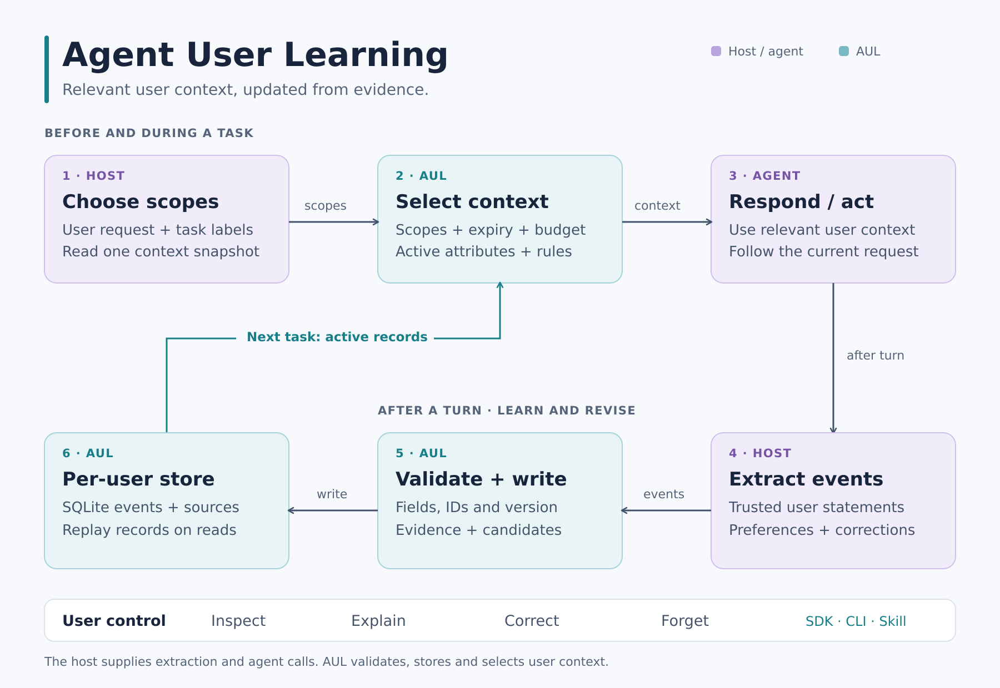

# Agent User Learning (AUL)

**Learn from what users tell an agent.**

[中文说明](README.zh-CN.md) · [Architecture](docs/architecture.md) · [Protocol](skills/agent-user-learning/references/protocol.md) · [Integration](skills/agent-user-learning/references/integration.md)

AUL stores what users share about their interests, preferences, goals, habits and background. Agents read the relevant context for a task, use it to guide their work, and update it when the user makes a correction.

For example, a user asks for brief progress updates while coding and detailed comments when reviewing a draft. AUL keeps the two preferences under separate task labels, so the agent can use the appropriate one next time.

Use the Python SDK, CLI or portable Skill to add user context to an agent or application.



The host chooses scopes and extracts events. AUL validates, stores and selects the user context. See [Architecture](docs/architecture.md) for the data flow and write contract.

## Where to use it

- Coding agents: keep preferences for explanations, code review and progress updates.
- Writing and study tools: use relevant goals, experience and preferred examples.
- Messaging apps: supply preferences for reply length and format; update them from user corrections.

## What it learns

| Category | Example | Effect on help |
| --- | --- | --- |
| Profile | User-stated name or experience | Address the user appropriately; choose a suitable starting level |
| Interests, likes, dislikes | Prefers a quiet workspace | Avoid unwanted suggestions in a work context |
| Goals | Finish a first draft | Prioritize the next useful step |
| Habits and constraints | Studies in short sessions; needs accessible formatting | Fit plans to the user's routine and stated needs |
| Current state | Busy today, with an expiry | Adapt this session without making a permanent assumption |
| Help preferences | Short examples; explanation before code | Adjust communication and workflow |

**User attributes** describe the user's background and needs. **Behavior rules** describe how they want help. Each record keeps its source, and the user can correct or forget it. An agent reads a small set of relevant records for the current task.

## Try it locally

Python 3.11 or newer. From this repository:

```sh
python -m pip install .
python examples/user_learning_demo.py
```

The offline demo uses a fictional user and an in-memory database. It shows how a goal and a preference enter the context, how a correction replaces an old value, and what remains after forgetting.

To use the SDK, run this example from the repository directory after installation:

```python
from agent_user_learning import UserLearner

# Store the demo database beside the repository.
with UserLearner("../aul-demo.db", "demo-user") as learner:
    learner.observe({
        "event_id": "extract:user-message-42:goal",
        "source_id": "user-message-42",
        "session_id": "session-7",
        "kind": "attribute",
        "scope": "writing:blog",
        "key": "goals.finish-draft",
        "value": "Wants to finish a first draft.",
        "signal": "explicit",
        "evidence": "User says they want to finish a first draft."
    }, expected_version=learner.version)
    context = learner.context(["writing", "writing:blog"])
    # Give this context to your agent as lower-priority user data.
    print(context["user"]["goals"])
```

This writes a fictional goal to `../aul-demo.db`. You can inspect the same database with the CLI:

```sh
aul --db ../aul-demo.db --user-id demo-user context --scope writing:blog
aul --db ../aul-demo.db --user-id demo-user inspect
aul --db ../aul-demo.db --user-id demo-user explain --kind attribute --rule-id 'writing:blog|goals.finish-draft'
```

For real users, choose a private location outside the repository, create its parent directory, and keep a separate database for each user.

## Use as a Skill

Copy the complete `skills/agent-user-learning` directory into the location used by your agent. The bundled runtime uses only the Python standard library; installing the SDK is optional for Skill use.

| Host | Project location | Personal location |
| --- | --- | --- |
| Codex | `.agents/skills/agent-user-learning/` | `~/.agents/skills/agent-user-learning/` |
| Claude Code | `.claude/skills/agent-user-learning/` | `~/.claude/skills/agent-user-learning/` |
| OpenCode | `.opencode/skills/agent-user-learning/` | `~/.config/opencode/skills/agent-user-learning/` |

See the hosts' official [Codex](https://developers.openai.com/codex/skills/), [Claude Code](https://code.claude.com/docs/en/skills), and [OpenCode](https://opencode.ai/docs/skills/) documentation. The host needs to call AUL before and after tasks; copying the Skill exposes its instructions and runtime but does not create those calls. See [Integration](skills/agent-user-learning/references/integration.md) for the workflow.

## How learning works

1. Your application chooses task labels, called scopes, and reads `context()` before the agent starts work.
2. The agent uses the relevant context along with the user's current request.
3. After the interaction, your application turns useful user statements into structured events and writes them to AUL.
4. Explicit statements and corrections take effect when written. Inferred interests or habits need matching evidence from two distinct sources in two sessions. Profile and constraint records require explicit statements.
5. The user can inspect, explain, correct or forget records.

Your application selects the scopes. `general` is always included, and later supplied scopes take precedence for the same key. Temporary `current.*` records need an expiry. Inferences cannot replace explicit records in the same scope. The [Protocol](skills/agent-user-learning/references/protocol.md) covers event formats, version checks, retries and forgetting.

## Status and development

Version **0.1.0** is a local prototype built with Python's standard library and SQLite. AUL processes structured events; the host supplies extraction from messages, task selection and agent calls. The host also handles authentication, storage permissions and deletion from backups. The database uses schema 2; migration from earlier prototypes is not included.

```sh
python -m pip install .
python -m unittest discover -s tests -v
python scripts/sync_skill.py --check
```

Change the SDK engine first, then run `python scripts/sync_skill.py` to regenerate the portable runtime. Tests cover user understanding, behavior adaptation, scope precedence, expiry, forgetting, replay, concurrent writers, bounded context and offline CLI portability.

Next steps are host adapters and real interaction testing: whether users need fewer repeated corrections, whether tasks are completed more effectively, and whether irrelevant preferences stay out of the response.

## Project guide

| Resource | Contents |
| --- | --- |
| [Architecture](docs/architecture.md) | Lifecycle, components, storage and conflict handling |
| [Protocol](skills/agent-user-learning/references/protocol.md) | Event fields, scopes, context limits and user controls |
| [Integration](skills/agent-user-learning/references/integration.md) | Host responsibilities and evaluation |
| [Contributing](CONTRIBUTING.md) | Setup, changes, checks and reproducible reports |
| [Changelog](CHANGELOG.md) | Prototype features and current source changes |

Licensed under [MIT](LICENSE).
